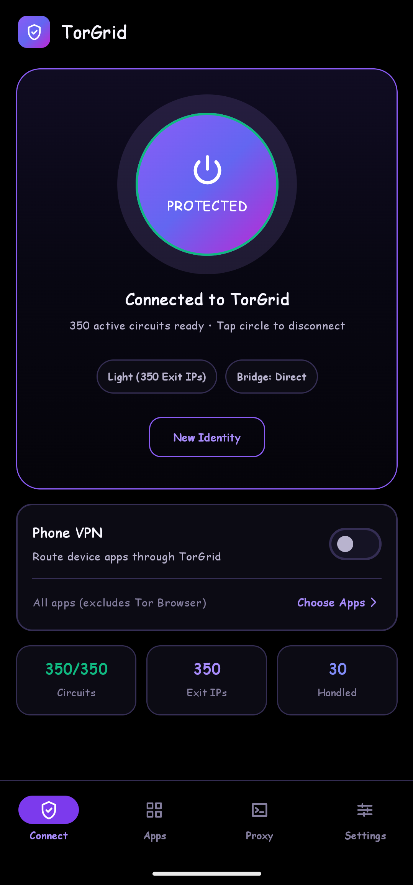
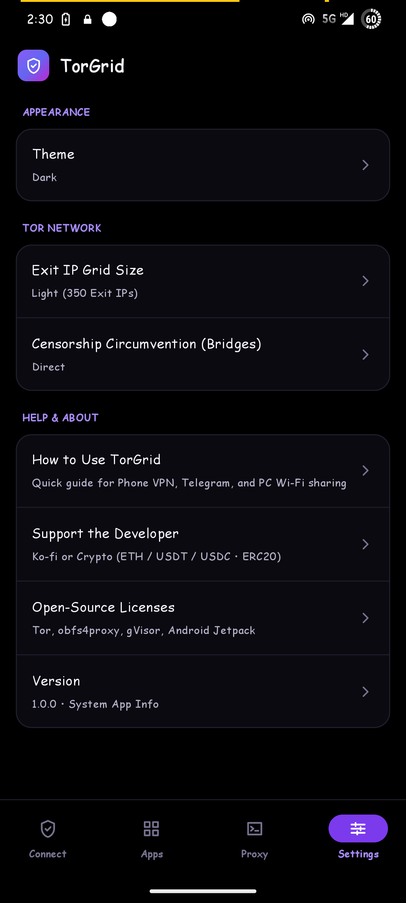

# TorGrid

**Self-Healing Multi-Circuit Tor Proxy (`100`–`1,100` Parallel Unique Exit IPs) & Split-Tunnel Android VPN** — available for **Android**, **Windows**, and **Linux**.

TorGrid connects hundreds of **strictly unique, non-duplicate Tor Exit IPs in parallel** behind a single local `SOCKS5` (`:10000`) and `HTTP/HTTPS` (`:8080`) gateway—automatically disconnecting duplicate or dead circuits and replacing them from the global Tor consensus pool without ever disturbing your already-connected unique IPs.

---

## Direct Downloads (`v1.0.0` — 100% Free & Ad-Free)

| Platform | Download | Details |
| :--- | :--- | :--- |
| **Android (`arm64` + `arm32`)** | [**Download `torgrid.apk`**](https://github.com/localhost-server/TorGrid/releases/latest/download/torgrid.apk) | Universal APK (Android 8.0+) • Whole-Phone & Per-App VPN + Local/Wi-Fi Proxy (`tor` & `obfs4proxy` bundled) |
| **Debian / Ubuntu / Kali (`amd64 .deb`)** | [**Download `torgrid_1.0.0_amd64.deb`**](https://github.com/localhost-server/TorGrid/releases/latest/download/torgrid_1.0.0_amd64.deb) | 1-command `apt` installer • Native **System Tray** indicator + auto-installs `tor` & `obfs4proxy` |
| **Debian / Raspberry Pi (`arm64 .deb`)** | [**Download `torgrid_1.0.0_arm64.deb`**](https://github.com/localhost-server/TorGrid/releases/latest/download/torgrid_1.0.0_arm64.deb) | 1-command ARM64 `apt` installer (Raspberry Pi OS 64-bit, Debian/Ubuntu ARM64) |
| **Windows (`x86_64`)** | [**Download `torgrid-windows-amd64.exe`**](https://github.com/localhost-server/TorGrid/releases/latest/download/torgrid-windows-amd64.exe) | Zero-terminal **Windows System Tray** `.exe` (shows active IP, Connect/Disconnect, & LAN toggle) |
| **Linux Portable (`x86_64` / `ARM64`)** | [**`torgrid-linux-amd64`**](https://github.com/localhost-server/TorGrid/releases/latest/download/torgrid-linux-amd64) · [**`torgrid-linux-arm64`**](https://github.com/localhost-server/TorGrid/releases/latest/download/torgrid-linux-arm64) | Standalone static binaries for Arch, Fedora, Alpine, or headless servers |
| **SHA-256 Checksums** | [**`SHA256SUMS`**](https://github.com/localhost-server/TorGrid/releases/latest/download/SHA256SUMS) | Verify integrity of all official release binaries |

> **Auto-Updates on Android via [Obtainium](https://github.com/ImranR98/Obtainium):** Paste `https://github.com/localhost-server/TorGrid` into Obtainium to receive automatic APK updates directly from GitHub Releases.

---

## Screenshots

<p align="center">
  
  &nbsp;&nbsp;
  
</p>

<p align="center">
  
</p>

---

## Key Features

- **Parallel Unique Exit IP Grid (`100` / `350` / `700` / `1,100` Exit IPs):**
  - Connects your chosen number of **distinct Tor Exit IPs** concurrently across isolated multi-daemon circuits.
  - **Older Unique IPs Protected:** Once an Exit IP connects, it is locked to its slot; any newly built circuit that lands on a duplicate or unresponsive IP is immediately disconnected and replaced from the ~890+ spare consensus pool.
  - **Full Live Transparency:** View and copy the complete live list of every connected Exit IP (`#001`..`#N`) in 1 tap.
- **Whole-Phone & Per-App Android VPN + Simultaneous Proxy:**
  - Route all apps (automatically bypassing native Tor apps like *Tor Browser* & *OnionShare* to prevent Tor-over-Tor) or choose specific apps via split-tunneling—while `:10000` (`SOCKS5`) and `:8080` (`HTTP/HTTPS`) work simultaneously.
  - 1-Tap **Add SOCKS5 Proxy to Telegram**.
- **Public Wi-Fi Safe by Default (`Share on Wi-Fi LAN` Firewall):**
  - **OFF (Default — Device-Only `127.0.0.1`):** Blocks everyone else on public café, airport, hotel, or college Wi-Fi (`403 Forbidden`).
  - **ON:** Unlocks `:10000`, `:8080`, and the live-synced **Browser Dashboard** (`/dashboard`) for your PC or Hotspot devices, with optional password protection.
- **Built-in Censorship Circumvention (`obfs4` Bridges):**
  - Switch between **Direct** (fastest), **Built-in `obfs4`**, or **Custom Bridges** from Telegram `@GetBridgesBot`.

---

## Exit IP Grid Sizes

| Mode | Parallel Unique Exit IPs | Best For |
| :--- | :--- | :--- |
| **Eco** | **`100` Exit IPs** | Everyday Phone VPN browsing, Telegram, or `obfs4` bridges |
| **Light** *(Default)* | **`350` Exit IPs** | Best daily balance for Phone VPN + PC Wi-Fi proxy browsing |
| **Standard** | **`700` Exit IPs** | Multi-tab OSINT research, QA testing, and high-concurrency rotation |
| **Turbo** | **`1,100` Exit IPs** | Maximum rotation across nearly the entire global Tor exit pool |

---

## Quick Start

### 1. Android (`torgrid.apk`)
1. Download and install [**`torgrid.apk`**](https://github.com/localhost-server/TorGrid/releases/latest/download/torgrid.apk).
2. Tap **Connect** on the home screen (and switch on **Phone VPN** if you want device apps routed through TorGrid).
3. Open the **Proxy** tab to copy `:10000` (`SOCKS5`) / `:8080` (`HTTP`), add to Telegram in 1 tap, inspect all live connected Exit IPs, or enable **Share on Wi-Fi LAN** for your PC.

### 2. Linux PC (`.deb` Package or Portable Binary — System Tray Mode)
```bash
# Option A — Debian / Ubuntu / Kali / Mint (.deb auto-installs tor & obfs4proxy + System Tray launcher):
sudo apt install ./torgrid_1.0.0_amd64.deb
torgrid --daemon
# (Or click "TorGrid" in your App Menu — manage everything right from your top System Tray icon!)

# Option B — Portable binary (Arch / Fedora / any distro):
sudo pacman -S tor lyrebird   # or: sudo dnf install tor obfs4proxy
chmod +x torgrid-linux-amd64
./torgrid-linux-amd64 --daemon
```

### 3. Windows PC (`torgrid-windows-amd64.exe` — System Tray Mode)
1. Ensure **Tor Browser** is installed *or* extract `tor.exe` from the official [Tor Expert Bundle](https://www.torproject.org/download/tor/) into the same folder as `torgrid-windows-amd64.exe` (or in `PATH`).
2. Double-click **`torgrid-windows-amd64.exe`** — runs silently in your **Windows System Tray** (zero terminal window) showing your active proxy IP (`127.0.0.1` or Wi-Fi LAN IP), Connect/Disconnect, Grid Size, and Share on Wi-Fi LAN switch.

### 4. Using the Proxy from Any App, Browser, or Script
```bash
# SOCKS5 Rotating Proxy (rotates Exit IP on every new TCP connection):
curl --socks5-hostname 127.0.0.1:10000 https://api.ipify.org?format=json

# HTTP / HTTPS Rotating Proxy:
curl -x http://127.0.0.1:8080 https://api.ipify.org?format=json
```

---

## Verification & Official Signing Fingerprint

- **Android APK Signing Certificate (`SHA-256`):**
  ```text
  c3989cd3a77c2061c0874073b64c169782db43762a0dca107826a650152df773
  ```
- Verify binary downloads against [`SHA256SUMS`](https://github.com/localhost-server/TorGrid/releases/latest/download/SHA256SUMS):
  ```bash
  sha256sum -c SHA256SUMS
  ```

---

## Support Development

TorGrid is **100% free and ad-free**. If it helps your workflow, you can support ongoing development:

- **Ko-fi:** [https://ko-fi.com/kaliansh](https://ko-fi.com/kaliansh)
- **Ethereum / ERC20 (`ETH` / `USDT` / `USDC`):**
  ```text
  0x9d7fa4d4b1daad6464d64851fa021f49f6e54836
  ```

---

## License & Third-Party Notices

- Distributed free of charge under the [TorGrid Freeware No-Resale License](LICENSE). Commercial resale, paywalling, or rebranded redistribution is strictly prohibited.
- Unmodified open-source component attributions (`Tor`, `obfs4proxy`, `gVisor`, `Go`, `Android Jetpack`) are listed in [THIRD_PARTY_NOTICES.md](THIRD_PARTY_NOTICES.md).
